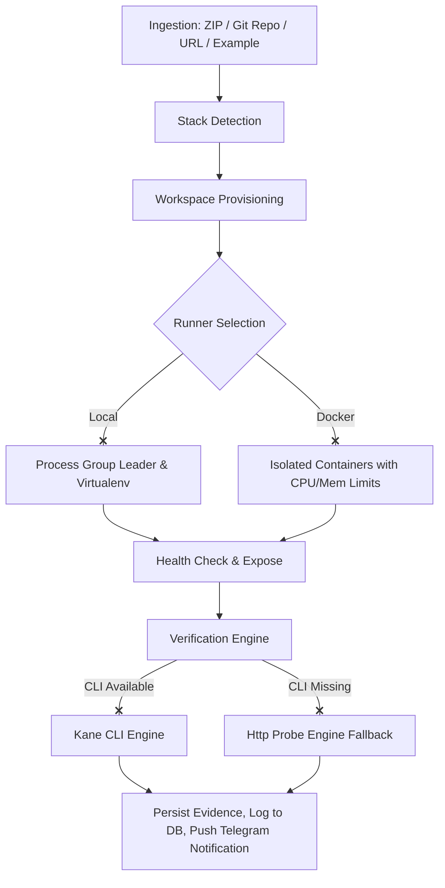

# VerifyHub: Technical Architecture & Codebase Analysis

VerifyHub is an AI-powered verification platform designed to ingest, build, run, and verify target applications in isolation. It detects stack configurations, provisions isolated runners, establishes local/public proxies, and verifies behavior using Playwright/Kane CLI or an honest HTTP fallback mechanism.

Below is a detailed breakdown of the components, lifecycle flow, and design patterns discovered in the workspace.

---

## 1. System Topology

---

## 2. Key Architecture Layers

### Core Stack
- **Framework**: [Next.js 16 (App Router)](file:///c:/Users/Wittylee/Desktop/Verify%20hub%202/verifyhub-source/verifyhub/src/app) / React 19 / TypeScript.
- **Styling**: Tailwind CSS v4 & shadcn/ui.
- **Database**: SQLite + [Prisma ORM](file:///c:/Users/Wittylee/Desktop/Verify%20hub%202/verifyhub-source/verifyhub/prisma/schema.prisma) representing the PostgreSQL-compatible schema.
- **Realtime**: [ws-service mini-service](file:///c:/Users/Wittylee/Desktop/Verify%20hub%202/verifyhub-source/verifyhub/mini-services/ws-service) (Socket.io) bridging backend run updates to the frontend dashboard.

---

## 3. Detailed Component Analysis

### A. The Engine Room ([`orchestrator.ts`](file:///c:/Users/Wittylee/Desktop/Verify%20hub%202/verifyhub-source/verifyhub/src/server/verifyhub/orchestrator.ts))
Drives the verification run state machine:
$$\text{QUEUED} \rightarrow \text{PREPARING} \rightarrow \text{CLONING} \rightarrow \text{INSTALLING} \rightarrow \text{BUILDING} \rightarrow \text{STARTING} \rightarrow \text{HEALTH\_CHECK} \rightarrow \text{EXPOSING} \rightarrow \text{READY} \rightarrow \text{KANE\_VERIFYING} \rightarrow \text{COLLECTING\_EVIDENCE} \rightarrow \text{COMPLETED}$$
- Saves all events as immutable `RunEvent` entries.
- Schedules runs dynamically using standard Cron expressions or human shorthand (e.g., `"every 30m"`).

### B. Project Detector ([`detect.ts`](file:///c:/Users/Wittylee/Desktop/Verify%20hub%202/verifyhub-source/verifyhub/src/server/verifyhub/detect.ts))
Autonomously detects:
1. **Node.js/Next.js/React**: Checks dependencies, scripts, package managers (`npm`/`yarn`/`pnpm`/`bun`), configs.
2. **Python (Django/FastAPI/Flask)**: Analyzes `requirements.txt`, entry points (`main.py`, `app.py`), and FastAPI decorators to resolve startup/port environments.
3. **Static Projects**: Detects standalone `index.html` or custom `Dockerfile`/`docker-compose.yml`.

### C. Runner Layer ([`runner.ts`](file:///c:/Users/Wittylee/Desktop/Verify%20hub%202/verifyhub-source/verifyhub/src/server/verifyhub/runner.ts))
Implements runner management with cleanup safety guarantees:
- **Local Runner**: Creates per-project Virtualenvs (`.verifyhub-venv`) for Python to avoid PEP 668 restrictions. Applications spawn in a detached process group, allowing cleanup via negative-PID `killTree` to destroy orphaned node/npm chain processes.
- **Docker Runner**: Enforces strict production-grade security:
  - 512MB RAM and 1.0 CPU limit.
  - `--security-opt no-new-privileges` and drops all capabilities.
  - Read-only root filesystem with scoped tmpfs (`/tmp:rw,size=64m`).
  - Runs under non-root UID `1000:1000`.

### D. Verification Engines ([`engines.ts`](file:///c:/Users/Wittylee/Desktop/Verify%20hub%202/verifyhub-source/verifyhub/src/server/verifyhub/engines.ts))
Supports dynamic engine resolution:
- **`kane` (CLI)**: Spawns the native CLI parser to drive Playwright test blocks.
- **`http-probe` (Fallback)**: An HTTP crawler fallback that parses same-origin navigation paths, resolves route candidates (e.g., `/login`), triggers probe checks, and creates structured execution logs/evidence inline. Fallbacks are marked honestly in the system timeline.

---

## 4. Key Configuration Files
- **[`schema.prisma`](file:///c:/Users/Wittylee/Desktop/Verify%20hub%202/verifyhub-source/verifyhub/prisma/schema.prisma)**: Main data models (`Project`, `Run`, `RunEvent`, `RunLog`, `VerificationSession`, `VerificationStep`, `Evidence`, `Schedule`, `Integration`, `Notification`, `WebhookDelivery`).
- **[`package.json`](file:///c:/Users/Wittylee/Desktop/Verify%20hub%202/verifyhub-source/verifyhub/package.json)**: Scripts list (`dev`, `build`, `start`, `db:push`, etc.).

---

## 5. Next Steps / Local Run Commands
To run the server and the realtime server locally, execute:
1. **Initialize DB**: `bun run db:push` or `npm run db:push`.
2. **Start Web Portal**: `bun run dev` (Runs on `http://localhost:3000`).
3. **Start Socket Accelerator**: `cd mini-services/ws-service && bun index.ts` (Runs on ports `3003` & `3004`).
